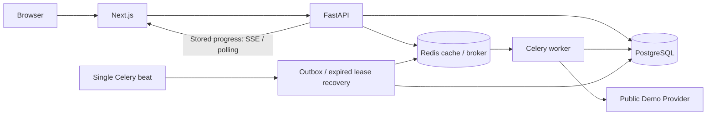
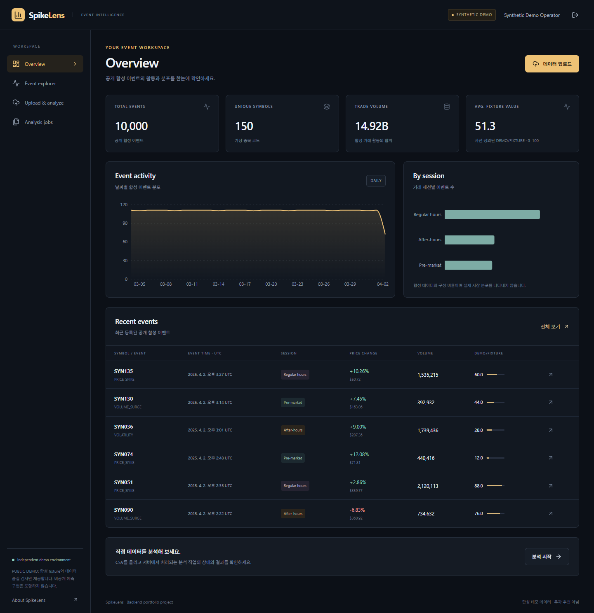
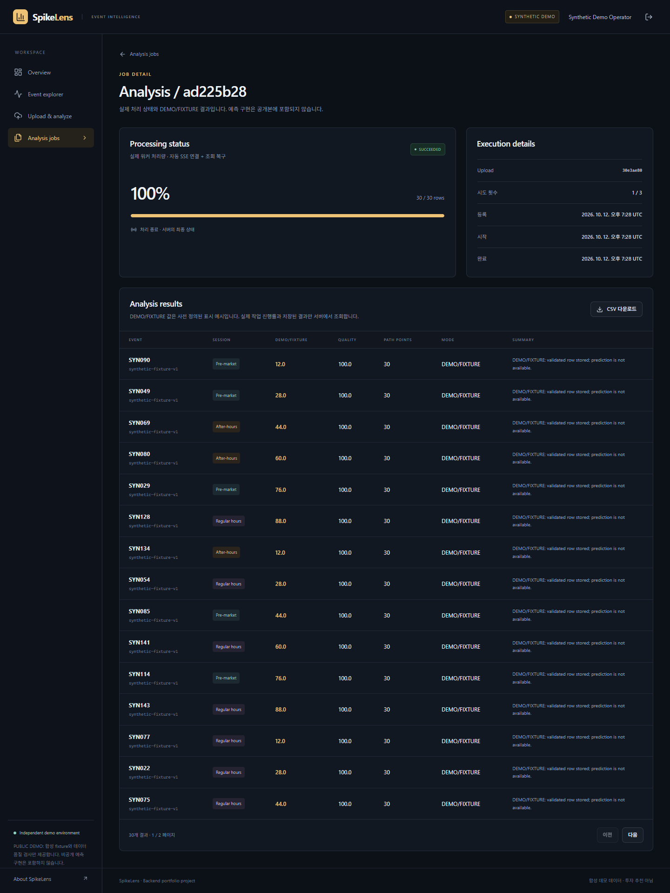

# SpikeLens — Full-stack Event Processing Portfolio

[](https://github.com/minsu0011/spikelens-portfolio/actions/workflows/ci.yml)

금융 이벤트의 조회·CSV 업로드·비동기 처리·시각화를 구현한 백엔드 중심 풀스택 포트폴리오다. 공개 버전은 **Synthetic Demo Mode**이며, 예측 모델·분석 알고리즘·학습 코드·가중치는 포함하지 않는다.

`DemoAnalysisProvider`는 검증된 행과 가격 관측값의 개수 등 일반적인 데이터 품질 정보를 기록한다. 화면의 **DEMO/FIXTURE** 값은 공개된 합성 상수이며 종목·가격·거래량으로 예측하지 않는다. CSV 업로드, DB 저장, Redis 메시징, Celery 처리, 작업 진행률과 결과 조회는 실제로 수행한다.

## 기술 스택과 주요 기능

| 영역 | 기술 |
|---|---|
| Frontend | Next.js 16, React 19, TypeScript, Tailwind 4, TanStack Query, Recharts |
| Backend | Python 3.12, FastAPI, Pydantic 2, SQLAlchemy 2, Alembic |
| Database / Async | PostgreSQL 17, Redis 7.4, Celery worker + beat |
| 실행 / 검증 | Docker Compose, pytest, Ruff, Playwright, GitHub Actions |

이벤트 CRUD와 종목·세션·날짜 필터, 회원가입·로그인·로그아웃, 소유자별 비공개 데이터 접근, CSV 검증, 중복 작업 방지, 실제 비동기 처리, SSE와 polling 복구, 결과 CSV, Redis 공개 요약 캐시와 관리자 지표를 구현했다. 공개 데모 10,000건은 고정 seed의 합성 생성기로 만든다.

## 시스템 구조



HTTP 요청에서 장시간 계산하지 않는다. Job을 DB에 먼저 commit하고 메시지를 게시한다. `pending_dispatch`가 남으면 beat가 제한된 횟수로 재게시한다. worker는 row lock과 lease token으로 claim하며, 오래된 worker의 쓰기는 fencing으로 차단한다. 소유자/idempotency key와 업로드/provider version의 UNIQUE 제약, 결과 UNIQUE 제약을 통해 동시 요청과 재전달을 처리한다.

## Docker Quick Start

Docker Engine와 Compose가 필요하다. Windows에서는 Docker Desktop의 Linux container 모드나 Docker가 설정된 WSL을 사용한다. 일반 Linux의 Docker 명령도 같다. 실제 검증은 Windows의 WSL2 Linux Docker 환경에서 수행했으며 macOS 실행은 아직 검증하지 않았다.

Windows PowerShell에서 프로젝트 루트로 이동한 뒤 실행한다.

```powershell
git clone https://github.com/minsu0011/spikelens-portfolio.git
cd spikelens-portfolio
python scripts/init_env.py
docker compose up --build -d --wait --wait-timeout 240
docker compose exec -T backend python -m app.db.seed --count 10000
```

Python이 호스트에 없으면 `.env.example`을 `.env`로 복사하고 `replace_with_new_random_urlsafe_password`의 모든 위치를 새 임의 URL-safe 비밀번호로 바꾼다. 실제 `.env`는 commit하지 않는다. 시작할 때 backend가 `alembic upgrade head`를 실행한다.

Linux:

```bash
git clone https://github.com/minsu0011/spikelens-portfolio.git
cd spikelens-portfolio
python3 scripts/init_env.py
docker compose up --build -d --wait --wait-timeout 240
docker compose exec -T backend python -m app.db.seed --count 10000
```

- 웹: **http://localhost:3200**
- API 문서: **http://localhost:8200/docs**
- PostgreSQL: loopback 55440, Redis: loopback 56380. 모든 published port는 127.0.0.1로 제한한다.

회원가입 후 [합성 CSV 30행](sample_data/events-small.csv)을 업로드하여 실제 분석 작업을 실행한다. 기본 계정이나 공통 데모 비밀번호를 자동 생성하지 않는다. 관리자 테스트가 필요하면 직접 가입한 계정에 아래 로컬 operator CLI를 사용한다.

```bash
docker compose exec -T backend python -m app.db.admin --email your-demo-account@example.com
docker compose ps
docker compose stop
```

`stop`은 데이터를 보존한다. `down --volumes`는 이 Compose 프로젝트의 데이터를 삭제하므로 재현용 환경 정리 시에만 사용한다.

## 테스트와 실행 증거

공개본은 원본 개발 환경의 검증을 그대로 가져오지 않고 다시 실행했다. 공개 준비 시점의 로컬 증거는 [PUBLIC_TEST_RESULTS.json](docs/evidence/PUBLIC_TEST_RESULTS.json), [PUBLIC_RUNTIME_QA.json](docs/evidence/PUBLIC_RUNTIME_QA.json)에 기록한다. 게시 후 실제 GitHub Actions 실행 결과는 [원격 CI 기록](https://github.com/minsu0011/spikelens-portfolio/actions/workflows/ci.yml)과 위 badge에서 확인한다. Cloud 배포는 수행하지 않았다.

최신 공개본 검증: **pytest 44개(단위 26 + 통합 18), 실제 브라우저 4개, 공개 guard 5개 통과**. 실패·skip 0이며 Ruff·TypeScript·ESLint·production build도 통과했다. 실제 공개본 Redis·worker·PostgreSQL 중단과 복구를 별도로 검증했다.

첫 원격 CI에서 service healthcheck의 single quote가 Docker 인자로 잘못 분리되는 문제를 발견했다. 실제 runner 로그의 `unknown shorthand flag: 'U'`를 확인하고 두 service 옵션을 double quote로 수정했다. 수정 전후의 원격 실행 이력을 숨기지 않고 보존한다.

```bash
# Docker가 실행 중인 프로젝트 루트에서 전용 test DB/Redis DB 2 검사
python3 scripts/test_backend_linux.py

# Frontend 디렉터리
npm ci
npm run typecheck
npm run lint
npm run build
npx playwright install chromium
npm run e2e

# 프로젝트 루트: 공개 파일 allowlist 및 비공개 의존성 검사
python3 scripts/public_leakage_guard.py
python3 scripts/test_public_guard.py
```

통합 fixture는 `spikelens_test` DB와 Redis DB 2 이상만 사용한다. 실제 worker subprocess, 16개 동시 요청, lease/fencing, 재시도 소진, 연결 거부, 인증·소유권·CSRF를 검사한다. 별도로 실제 공개본 컨테이너 중단·복구를 확인한다. 브라우저 검사는 실제 API와 2,000행 Celery 처리, SSE 차단 후 polling 복구를 포함한다.

## 설계와 검증 사례

Redis 장애 중 요청이 결과 backend 구독이나 메시지 연결 재시도로 오래 대기하지 않도록, API 게시에는 별도 2초 연결/socket 한도와 재시도 0, `ignore_result=True`를 적용한다. worker의 정상 재연결 정책은 유지한다. [작업 설계](docs/architecture/ASYNC_JOB_DESIGN.md)와 [공개본 장애 증거](docs/evidence/PUBLIC_RUNTIME_QA.json)를 함께 확인한다.

Argon2 비밀번호 hash, DB의 opaque 세션 digest, HttpOnly 쿠키, CSRF·Origin 검사와 서버의 소유권 조건을 사용한다. 계정과 peer의 로그인 제한을 분리하고 DB advisory lock으로 횟수 경쟁을 막는다. CSV는 10MiB/20,000행 제한, 필수 컬럼·날짜·숫자·중복·SHA·서버 저장 이름을 검증한다. [보안](docs/architecture/SECURITY.md).

실제 캐시·HTTP·EXPLAIN 측정은 [성능 문서](docs/architecture/PERFORMANCE.md)에 환경과 표본을 함께 기록한다. 작은 로컬 표본을 운영 SLO나 실제 서비스 운영 경험으로 소개하지 않는다.

## 실제 공개 데모 화면




## 공개 범위와 문서

새 Git repository에서 검사한 application snapshot만 관리한다. 과거 private history, 내부 자료, 비밀값, 모델 구현, 데이터 dump와 사용자 파일은 포함하지 않는다. SQLAlchemy의 `backend/app/models`는 ORM 테이블 정의이며 공개 가능한 애플리케이션 schema다. API 호환 필드 `anomaly_score`와 `model_version`은 공개본에서 각각 fixture 표시 값과 provider version을 저장한다.

- [구조](docs/architecture/SYSTEM_ARCHITECTURE.md), [ERD](docs/architecture/ERD.md), [API](docs/architecture/API_DESIGN.md)
- [포트폴리오 설명](docs/portfolio/PORTFOLIO_CASE_STUDY_KO.md), [면접 준비](docs/portfolio/INTERVIEW_PREPARATION_KO.md)
- [공개 파일 목록](public_allowlist.json), [공개 검사 결과](docs/evidence/PUBLIC_TEST_RESULTS.json)

공개 운영을 위해서는 HTTPS/Secure cookie, 이메일 인증·계정 복구, 저장소·백업 복원·경보, 운영 quota와 더 큰 부하 검증이 필요하다. 현재 공개 모델 기능과 투자 예측 기능은 제공하지 않는다.

AI/Codex의 도움으로 구현했다. 실제로 이해·검증한 범위를 설명하고 작성 기여를 과장하지 않는다. 프로젝트에 별도 라이선스를 부여하지 않았다.
