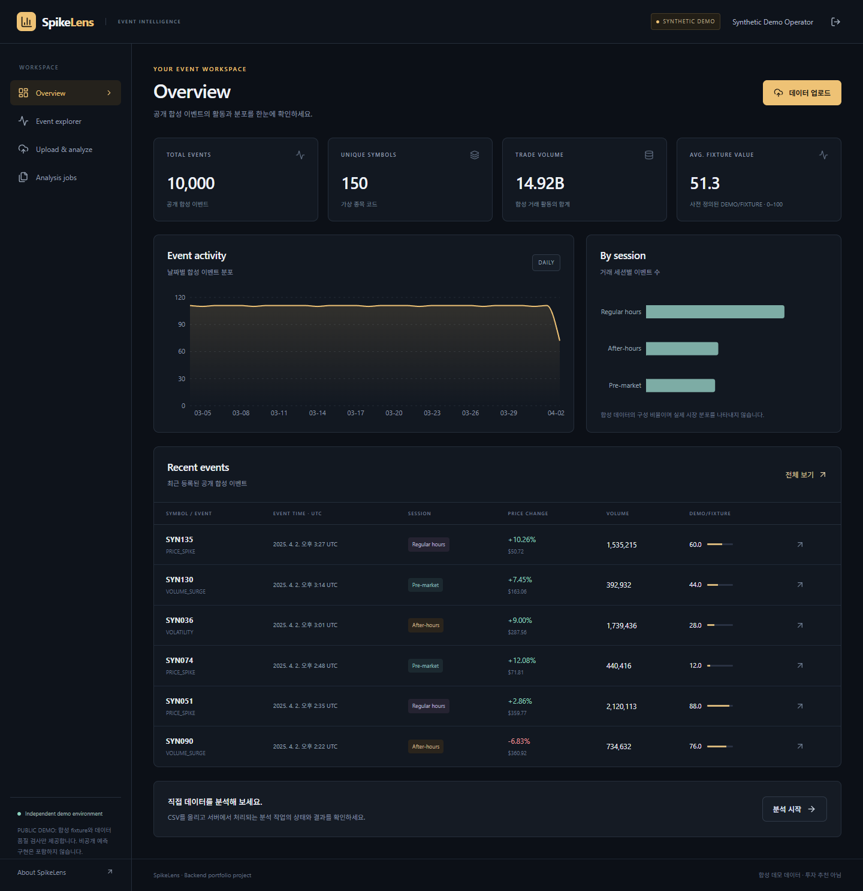
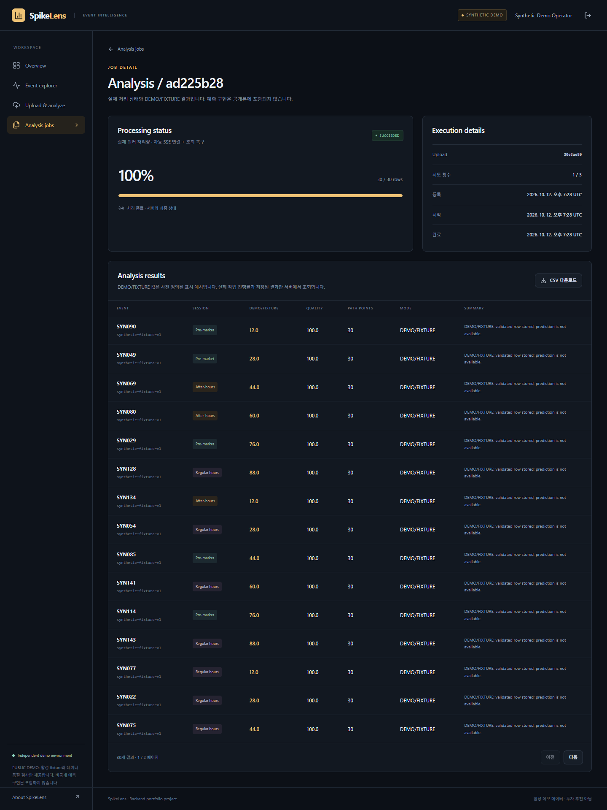

# SpikeLens

금융 이벤트의 조회, CSV 업로드, 비동기 처리와 시각화를 구현한 풀스택 애플리케이션입니다. 공개 데모의 분석 값은 합성 fixture이며 예측 모델과 학습 가중치는 포함하지 않습니다.

[](https://github.com/minsu0011/spikelens-portfolio/actions/workflows/ci.yml)

## 구성

| 영역 | 기술 |
| --- | --- |
| Frontend | Next.js 16, React 19, TypeScript, Tailwind 4 |
| Backend | FastAPI, Pydantic 2, SQLAlchemy 2, Alembic |
| Storage / Jobs | PostgreSQL 17, Redis 7.4, Celery |
| Development | Docker Compose, pytest, Playwright, GitHub Actions |

CSV 검증과 DB 저장 뒤 Celery 작업을 실행하고, 진행률은 SSE와 polling으로 전달합니다. DB outbox·lease·fencing을 사용해 재전달과 중단된 작업을 처리합니다. 회원가입, 세션 인증, 소유자별 접근 제어도 포함합니다.

## 실행

Docker와 Compose를 준비한 뒤 저장소 루트에서 실행합니다. Windows는 Linux container 환경을 사용합니다.

```bash
python scripts/init_env.py
docker compose up --build -d --wait --wait-timeout 240
docker compose exec -T backend python -m app.db.seed --count 10000
```

- 웹: http://localhost:3200
- API 문서: http://localhost:8200/docs
- [샘플 CSV](sample_data/events-small.csv)를 업로드해 작업을 실행할 수 있습니다.

실행 시 생성한 `.env`는 로컬에 보관합니다. 회원가입 후 사용할 수 있으며 기본 계정은 없습니다.

## 설계와 테스트

[시스템 구조](docs/architecture/SYSTEM_ARCHITECTURE.md) · [비동기 작업](docs/architecture/ASYNC_JOB_DESIGN.md) · [API](docs/architecture/API_DESIGN.md) · [보안](docs/architecture/SECURITY.md) · [성능 측정](docs/architecture/PERFORMANCE.md)

공개본 검증 기록은 [테스트 결과](docs/evidence/PUBLIC_TEST_RESULTS.json)와 [중단·복구 검사](docs/evidence/PUBLIC_RUNTIME_QA.json)에 있습니다. 최신 CI 실행은 위 배지에서 확인할 수 있습니다. 클라우드 운영 배포는 포함하지 않습니다.





[전체 문서 안내](docs/README.md)
