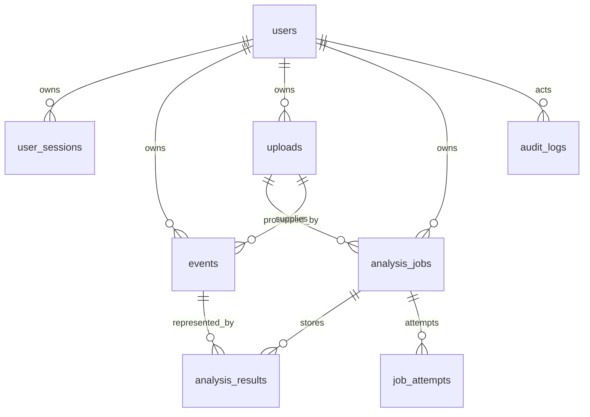

# 데이터베이스와 제약

UUID primary key, FK와 UNIQUE/index는 `backend/app/models/entities.py` 및 `backend/alembic/versions/0001_initial_schema.py`에 정의한다. 시간은 timezone-aware UTC다. 공개 합성 이벤트와 owner 전용 입력은 `is_public` 및 `owner_id`로 분리한다.

이벤트 source identity, owner+upload SHA, owner+idempotency key, owner+upload+provider version, job+event 결과와 job+attempt 조합의 제약이 중복을 통제한다. 이벤트 시각/id 및 종목·세션 복합 인덱스, owner별 업로드/작업 인덱스로 조회를 지원한다. 실제 migration으로 schema를 생성하며 ORM auto-create에만 의존하지 않는다.

`model_version`, `anomaly_score`는 기존 API schema의 호환 이름이다. 공개본에는 provider version과 사전 정의된 fixture만 들어가며 모델 파라미터나 예측 결과를 저장하지 않는다.
