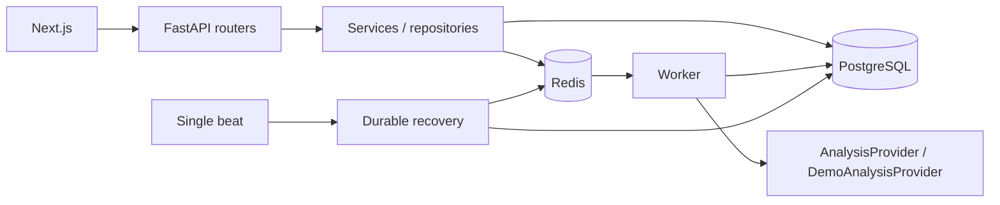

# 공개 애플리케이션 구조

Next.js는 동일 출처 `/api`를 FastAPI로 전달한다. Router가 schema·권한을 확인하고 Service가 트랜잭션/작업 상태를, Repository가 조회 조건을 관리한다. PostgreSQL이 사용자·이벤트·입력·작업·결과의 원장이며 Redis는 공개 요약 캐시와 Celery broker다.

`backend/app/providers/base.py`가 행 처리 계약을 정의한다. 공개 provider는 공개 fixture와 일반 검증 집계만 반환한다. 비공개 구현을 import하거나 mount하는 경로가 없고 ML dependency도 없다. 모델 없이도 입력 파일·큐·worker·DB 결과·SSE는 실제로 동작한다.

Compose 서비스 6개는 별도 네트워크와 PostgreSQL/Redis/업로드 볼륨을 사용한다. API와 worker는 비 root 사용자로 실행한다. 의존성 lock과 image digest로 재현성을 관리하며, runtime과 secrets는 build context 및 Git에서 제외한다.
